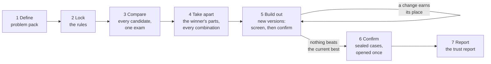

# The Reality Engine

*Find out, by experiment, how far an AI system can be trusted, why it fails, and what makes it better.*

Website: https://therealityengine.ca · White paper: https://llmjester.github.io/describing-reality-for-ai/ ·
The first case study's results and rules: [describing-reality-for-ai](https://github.com/LLMJester/describing-reality-for-ai)

This is the **generic engine**. Everything specific to a problem lives in a *problem pack*. The engine itself runs
the same locked stages, the same statistics and the same honesty rules for every problem, and writes a trust report.

**Status: version 0.1, the first separation of the engine from its first problem.** It has been proved two ways:

1. **Replay.** Run 5 of *Describing Reality for AI* was rerun through this engine from its saved records, with no
   model calls. The engine reached every one of run 5's decisions and **all 712 reported numbers** (means, ranges,
   effects, p values, Holm adjustments) exactly. See [The replay test](#the-replay-test).
2. **Live pilot.** A small new run on fresh test cases went through every step for real, with GPT-6 Luna doing the
   tasks and Claude Opus as the designer. See [The live pilot](#the-live-pilot).

## How it works



| Step | What happens | Code |
|---|---|---|
| 1 Define | A pack says what a candidate is, how test cases are made and scored, how a candidate splits into parts, and who writes new versions | `engine/pack.py`, `packs/` |
| 2 Lock | The plan (every rule of the run) and the code are fingerprinted ([pre-registration][prereg]). The run refuses to start if anything changed since | `engine/plan.py` |
| 3 Compare | Every candidate, the current setup (the control) among them, runs on the same cases. Means come with 95% [cluster-bootstrap][cluster] ranges. [Hsu's test][hsu] keeps every candidate that could still be best; leads over the control are [Holm][holm]-corrected | `Engine.compare` |
| 4 Take apart | The designer writes one new version of each of the winner's parts. Every combination is run (2^m, a [full factorial][factorial]). The gated keep rule decides | `Engine.takeapart_*` |
| 5 Build out | Up to N rounds. The designer writes several versions of each part from the firewalled brief. Each is screened alone on fresh cases against a fixed bar; the parts that pass are confirmed in every combination on more fresh cases | `Engine.round_*` |
| 6 Confirm | The sealed set is opened once. The final design meets the control and its closest rivals in a fixed order ([fixed-sequence gatekeeping][gatekeeping]) | `Engine.final` |
| 7 Report | Six numbers at a glance: how often it's right, reliability, why it fails, verdict, how hard we looked, headroom | `engine/report.py` |

**The keep rule.** A change is kept only if (a) its own effect survives Holm's correction with a positive estimate,
and (b) the design it gives then beats the current best head to head, with the whole 95% range above zero. Picking
the highest raw score would reward luck (the [winner's curse][curse]).

**The stopping rules.** The rounds stop when no part's best new version clears the screen's bar, when no mix beats
the current best, or when the gain falls below the convergence bar.

**The methods, at their sources.** [Pre-registration][prereg]: Nosek et al. (2018), PNAS. [Cluster bootstrap][cluster]:
Field and Welsh (2007), JRSS B. [Multiple comparisons with the best][hsu]: Hsu (1984), Annals of Statistics.
[Holm's correction][holm]: Holm (1979), Scandinavian Journal of Statistics. [Two-level full factorial
designs][factorial]: NIST/SEMATECH e-Handbook of Statistical Methods. [The winner's curse][curse]: Ioannidis (2008),
Epidemiology. [Fixed-sequence gatekeeping][gatekeeping]: FDA guidance, Multiple Endpoints in Clinical Trials (2022).

[prereg]: https://doi.org/10.1073/pnas.1708274114
[cluster]: https://doi.org/10.1111/j.1467-9868.2007.00593.x
[hsu]: https://doi.org/10.1214/aos/1176346732
[holm]: https://www.jstor.org/stable/4615733
[factorial]: https://www.itl.nist.gov/div898/handbook/pri/section3/pri3331.htm
[curse]: https://doi.org/10.1097/EDE.0b013e31818131e7
[gatekeeping]: https://www.fda.gov/media/162416/download

## Quick start (no model, no network)

```
pip install -r requirements.txt
python -m engine lock plans/toy.json --reason "first try"
python -m engine run plans/toy.json
```

In about ten seconds the toy pack goes through every step. Open `work/toy/report.html` for the trust report. The toy
problem has a hidden answer: one kind of fact-writing rule really helps. The engine doesn't know that; it finds out.

```
python -m pytest            # the engine tests on the toy pack; the replay test runs if the run 5 records are present
```

## Writing a pack

See **[docs/WRITING_A_PACK.md](docs/WRITING_A_PACK.md)**. In short, subclass `engine.pack.Pack`:

| Method | Returns |
|---|---|
| `founders()` | `{label: candidate}`; each candidate is a dict with a content-based `"id"` |
| `item_sets()` | `{set name: [item id, ...]}` |
| `run(candidate, item, ctx)` | `{"score": 0..1}`, or `{"error": ..., "failure": "design" \| "infra" \| "config"}` |
| `slots(kind)`, `parts(candidate, kind)` | The part names, and a candidate's current parts |
| `write(kind, candidate, parts, brief, slots, per_slot)` | New versions of the parts, written from the brief only |
| `compose(base, parts, changes, kind, extras)` | A candidate with some parts replaced |
| optional | `cluster_of`, `level_of`, `failure_type`, `evidence`, `prepare`, `open_sealed`, `retired_items`, `report_extras` |

Then write a plan (copy `plans/toy.json`), lock it and run it.

## A run's work folder

```
work/<plan name>/
  PLAN.LOCK, LOCKS.log       the fingerprint, and every lock with its reason
  state.json                 the step it is on, the current best, every decision as an event
  analysis.json              every step's statistics
  records/<folder>/<id>/<item>/record.json   one per run (failed attempts kept as record.void<N>.json)
  candidates/<id>.json       every candidate the run built
  stages/<step>/             the designer's brief, its frozen versions, and APPROVED (or REJECT)
  report.json, report.html   the trust report
```

To pause, create `work/<plan name>/PAUSE`: running jobs finish and nothing is lost. Run the same command again to
resume.

## Built to be honest

- **Locked in advance.** Rules and code are fingerprinted before the first result, and every change is logged and
  re-locked.
- **No peeking.** The designer sees a brief made of scores only: never a test case, an answer key or a sealed result.
- **Like for like.** Every candidate in a step faces the same cases, and comparisons are paired.
- **Sealed final check.** The engine refuses to run sealed cases before step 6, and it opens them once.
- **Failures count.** A design-caused failure scores 0 and is never dropped. An infrastructure failure stops the run
  for a person and is never scored.
- **Nothing deleted.** Every record, candidate, frozen version and decision is kept.

## The first pack: Describing Reality for AI

`packs/describing_reality/` is run 5 of the Discovery Programme as a pack. A small model (GPT-6 Luna) reads a long,
messy description of a system, writes notes in a prescribed format, and later answers questions from its notes
alone. The pack is an **adapter**: the problem code itself (designs, the two-phase episode, the grader, the
designer's prompts and checks) is the code that ran run 5, kept unchanged in
[`packs/describing_reality/run5/`](packs/describing_reality/run5/). Read it to see exactly how the case study was
built, or copy its shape for your own problem.

Two parts are deliberately not public:
- **The world generator** that makes the test systems and their answer keys. With it, anyone could rebuild the answer
  keys of sealed test sets.
- **The run records**, for the same reason. The cleaned results are published in describing-reality-for-ai/results.

So the replay test and the live pack run only where those are present. The engine, the toy pack and their tests run
anywhere.

### The replay test

`plans/run5_replay.json` uses run 5's locked rules. `ReplayPack` returns the score run 5 recorded for each design and
item, and the texts the designer wrote then, so the engine re-makes every decision itself:

| Step | Engine (replay) | Run 5 |
|---|---|---|
| Compare: winner, runner-up, top on hand-written | FACTS, A3 (tied), ONT_LOOSE | FACTS, A3 (tied), ONT_LOOSE |
| Take apart: 32 designs, keep rule | D01 (FACTS kept; no part kept) | D01 |
| Round 1 (stage 3): screen | layout and rules advance | slots 1 and 2 advance |
| Round 1: confirmation | no mix beats FACTS; the rounds stop | the same |
| Final check on sealed2 (720 cases) | vs A0P +0.163 [0.140, 0.186] counted; vs ONT_LOOSE +0.164 counted; vs A3 +0.023 [−0.002, 0.048] not counted | the same |

`python scripts/compare_replay.py` checks the two analyses field by field: **712 values match, 0 differ.**

### The live pilot

`plans/pilot.json` (pilot1, 31 October 2026) ran every step for real on **fresh** systems that no earlier run had
used (`plans/pilot_items.json`). GPT-6 Luna did the tasks through Codex, and Claude Opus wrote the new versions from
the engine's brief. It made 672 runs in 38 minutes, unattended (approval "auto").

| Step | What happened |
|---|---|
| Compare: 4 founders × 32 cases (8 systems) | FACTS 72% [67–78], SEC_FLOW 64%, SEC_A1 51%, A0P (plain prose) 51% |
| Take apart: Opus wrote new layout, rules and answering; 8 designs × 32 | No part earned its place; FACTS kept |
| Round 1: Opus wrote 4 versions of each part; screen 13 × 16 | One version (answering 2, +0.034) cleared the bar |
| Round 1: confirmation 2 × 16 | It did not beat FACTS; the rounds stop |
| Final check on 16 sealed cases (4 systems) | FACTS 68% [53–80]; vs A0P **+0.18 [0.07, 0.29], counted**; vs SEC_FLOW +0.21 [−0.16, 0.57], not counted |

The pilot was only meant to show that the engine works end to end, and it does. Its pattern matches run 5: FACTS
wins, it beats plain prose on sealed cases, and nothing the designer tried improved it. But it is far too small to be
a result: with 4 sealed systems, even a 21-point lead over SEC_FLOW can't be told apart from chance. Its trust
report, analysis and the designer's frozen versions are in `work/pilot1/`.

## Two repositories

| Repository | What it is for |
| --- | --- |
| **reality-engine** (this one) | The engine, to run the method on your own problem. The first case study is its first pack, with its code |
| **[describing-reality-for-ai](https://github.com/LLMJester/describing-reality-for-ai)** | The details of the first case study: the white paper, its results and the rules it was run under |

## Contributing

Packs for new problems are the most useful contribution. A good first pack is any choice you currently make by
habit: a prompt layout, a retrieval format, an agent's instructions. Bring a scorer you trust and enough fresh cases
for every step. Open an issue to discuss it first. Changes to the engine must keep the tests passing, including the
replay test where the records are available.

## Licence

MIT. See [LICENSE](LICENSE).
